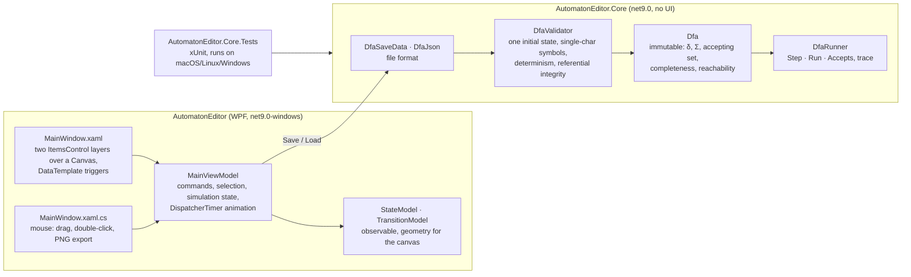
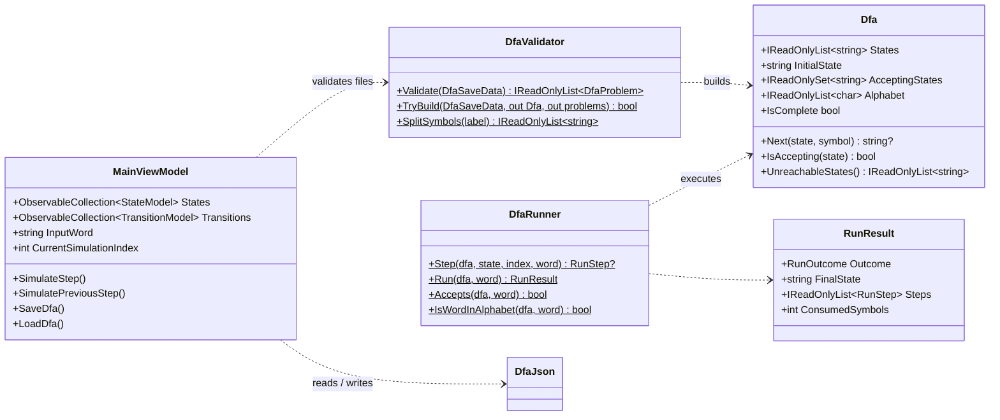

# DFA Designer & Simulator

A WPF desktop application for drawing deterministic finite automata on a canvas and watching
them process input words step by step or as an animation. The automaton logic (model,
validation, execution) lives in a framework-free library with its own test suite, so the
rules of a DFA are checked the same way whether a transition is added in the editor or read
from a JSON file.

Created for the Programming in Graphical Environments course at Warsaw University of
Technology (4th semester, 2026). Windows only at runtime (WPF, .NET 9); the core library and its
tests run on any platform.

## Preview

| Adding and dragging states | Customising state appearance |
| :--: | :--: |
|  |  |
| Adding transitions and self-loops | Step-by-step simulation |
|  |  |
| Animation mode with speed control | Import and export |
|  |  |

## Features

- **Canvas editor.** Double-click to add a state (`q0, q1, …`), drag to move, click to select.
  Initial and accepting flags are checkboxes; marking a new initial state clears the previous
  one. Accepting states draw a double circle.
- **Appearance bound to the model.** Fill, border colour, radius and border thickness of the
  selected state are edited through controls bound to the `StateModel`; the canvas updates
  instantly.
- **Transitions.** From/to dropdowns and a label such as `0,1` (one or more single characters).
  Regular transitions are quadratic Bézier curves with an arrowhead, self-loops are arcs,
  opposite transitions between the same pair are offset so they do not overlap. The alphabet Σ
  is derived from all labels. The editor refuses a second transition on the same symbol from
  the same state, which is what keeps the automaton deterministic.
- **Simulation.** The input word is validated against Σ. `KROK`/`WSTECZ` step forward and back
  with the current state, transition and symbol highlighted; `Start`/`Stop`/`Reset` animate at
  200–2000 ms per step. A history list records every `(state, symbol) → state` step. The result
  is reported as accepted, rejected, or stuck (no transition for the symbol, for partial DFAs).
- **JSON import/export and PNG export.** Files are parsed and validated by the core library
  before anything is drawn; the error dialog lists every problem found. Three sample automata
  ship with the app in `Samples/`.

## Architecture



The application follows MVVM: all state is in `MainViewModel`, the XAML binds to it, and the
code-behind handles only low-level mouse events and the PNG export. Simulation state is a
`Stack<StateModel>` of visited states; a forward step pushes, a backward step pops. Animation
runs the same step on each `DispatcherTimer` tick.



## Engineering decisions

- **Validation is centralised and re-applied to files.** The editor prevents non-determinism
  interactively, but a JSON file can be edited by hand. `DfaValidator` checks every rule
  (exactly one initial state, unique ids and names, single-character symbols, no
  ε-transitions, no two transitions on the same symbol from one state, no dangling references)
  and returns all problems at once, so the user fixes the file in one go instead of
  discovering errors one dialog at a time.
- **The DFA is immutable and UI-free.** `Dfa` keys δ by `(state, symbol)` and derives Σ from
  it; `DfaRunner` is a pure function of the automaton and the word. This is what makes the
  behaviour testable on a Linux CI runner without WPF.
- **Partial DFAs are allowed and reported.** Missing transitions do not fail validation; a run
  that hits one ends with `Stuck` and says where. `Dfa.IsComplete` and
  `Dfa.UnreachableStates()` expose the two most common modelling mistakes.
- **Geometry stays in the view models.** Bézier control points, label positions and arrow
  angles are computed in `TransitionModel` from the two endpoints and re-published when a state
  moves, so dragging a state redraws its transitions through ordinary bindings.
- **No MVVM framework.** `ObservableObject` and `RelayCommand` are 40 lines; the project does
  not need more.

## Getting started

Requirements: .NET SDK 9.0. Running the application requires Windows 10/11.

```bash
git clone https://github.com/anniigr/DFA-Designer-and-Simulator.git
cd DFA-Designer-and-Simulator
dotnet run --project AutomatonEditor          # Windows
dotnet test AutomatonEditor.Core.Tests        # any OS
```

On macOS or Linux the WPF project can still be compiled for inspection with
`dotnet build AutomatonEditor -p:EnableWindowsTargeting=true`.

### Using the editor

1. **Lab** tab: double-click the canvas to add states; tick *Initial* on one and *Accepting*
   on the final ones; add transitions with the form below the canvas.
2. **Home** tab: type an input word (only symbols from Σ are accepted), then use `KROK` /
   `WSTECZ` or `Start`.
3. **Load** opens the `Samples` folder shipped with the executable:
   `even-zeros.json` (binary words with an even number of zeros), `ends-with-ab.json`,
   `divisible-by-3.json` (binary numbers divisible by three).

### JSON format

```json
{
  "States": [
    { "Id": "q0", "Name": "q0", "X": 120, "Y": 180, "IsInitial": true,  "IsAccepting": true  },
    { "Id": "q1", "Name": "q1", "X": 360, "Y": 180, "IsInitial": false, "IsAccepting": false }
  ],
  "Transitions": [
    { "FromId": "q0", "ToId": "q1", "Symbol": "0" },
    { "FromId": "q0", "ToId": "q0", "Symbol": "1" },
    { "FromId": "q1", "ToId": "q0", "Symbol": "0" },
    { "FromId": "q1", "ToId": "q1", "Symbol": "1" }
  ]
}
```

`Symbol` may list several single characters separated by commas (`"0,1"`); `Id` is any unique
string (the editor generates GUIDs).

## Testing

```bash
dotnet test AutomatonEditor.Core.Tests
```

| Area | What is covered |
| --- | --- |
| `DfaValidatorTests` | Well-formed build; no states; zero or several initial states; non-determinism; multi-character and empty symbols; dangling transitions and duplicate ids; unreachable states and incomplete δ; label splitting |
| `DfaRunnerTests` | Acceptance table for the even-zeros automaton; full trace of a run; symbols outside Σ; partial DFA getting stuck with position; step-by-step equals the full run |
| `DfaJsonTests` | JSON round trip; malformed documents reported, not thrown; every shipped sample is a valid DFA |

CI (`.github/workflows/ci.yml`) runs the core tests on Ubuntu and builds the WPF solution on
Windows for every push and pull request. The interactive canvas behaviour is demonstrated by
the recordings above; it is not covered by automated UI tests.

## Project structure

```
DFA-Designer-and-Simulator/
├── AutomatonEditor/                 WPF application
│   ├── MainWindow.xaml(.cs)         canvas, templates, mouse handling, PNG export
│   └── Core/                        MainViewModel, StateModel, TransitionModel, converters
├── AutomatonEditor.Core/            Dfa, DfaValidator, DfaRunner, DfaSaveData, DfaJson
├── AutomatonEditor.Core.Tests/      xUnit tests
├── Samples/                         example automata (copied next to the executable)
├── Images/                          recordings used above
└── task_pl_*.{md,pdf}               original course assignment (Polish)
```

## Limitations

- **UI strings are Polish** (course requirement); the README and the core library are English.
- **No NFA, ε-transitions or minimisation.** The tool models DFAs only; files with ε or
  duplicate symbols are rejected rather than converted.
- **Editing during a simulation is not blocked.** Deleting the current state mid-run resets
  the simulation on the next step.
- **PNG export renders the current visual tree**, so very large automata are exported at
  screen resolution.
- **No automated UI tests**; WPF interaction is verified manually (see the GIFs).
